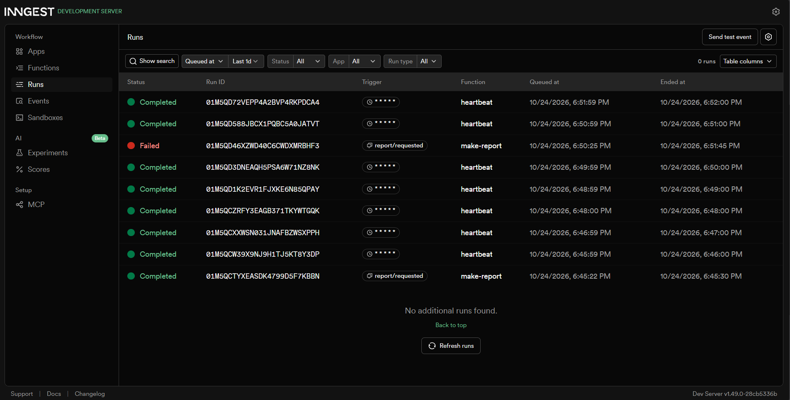

# Background Report Job with Express and Inngest

This project demonstrates how to accept a report request through an Express API
and process the slow work asynchronously with Inngest.

The API responds immediately with `202 Accepted` while the report is being
processed in the background. The client can then poll a status endpoint until
the report is complete. The example also includes input validation, retry
behavior, a cron-triggered heartbeat function, and an Inngest dashboard view.

## Features

- Express HTTP API
- Asynchronous report generation with Inngest
- In-memory report storage for a simple local demonstration
- `400 Bad Request` validation for a missing or invalid `topic`
- `404 Not Found` handling for unknown report IDs
- Two retries for failures in the report function
- Cron-based heartbeat that logs report statistics
- Local Inngest dashboard integration

## Requirements

- Node.js 18 or newer
- npm

## Getting Started

Install the dependencies:

```bash
npm install
```

Start the Express application:

```bash
node app.js
```

The API is available at <http://localhost:3000>.

In a second terminal, start the local Inngest Dev Server so that it can discover
and execute the functions exposed by the application:

```bash
npx inngest-cli@latest dev
```

The Inngest endpoint is exposed at:

<http://localhost:3000/api/inngest>

The Inngest Dev Server dashboard is normally available at:

<http://localhost:8288>

## API Routes

### `GET /health`

Returns a basic health check:

```json
{
  "status": "ok"
}
```

### `POST /reports`

Queues a report-generation job.

Request:

```http
POST http://localhost:3000/reports
Content-Type: application/json
```

```json
{
  "topic": "background jobs"
}
```

Successful response: `202 Accepted`

```json
{
  "id": "generated-report-id",
  "topic": "background jobs",
  "status": "pending"
}
```

The `topic` field is required and must be a non-empty string. Invalid input
returns `400 Bad Request`:

```json
{
  "error": "Field 'topic' is required"
}
```

### `GET /reports/:id`

Returns the current state of a report.

While the background job is running:

```json
{
  "id": "generated-report-id",
  "topic": "background jobs",
  "status": "pending"
}
```

After successful processing:

```json
{
  "id": "generated-report-id",
  "topic": "background jobs",
  "status": "done",
  "result": "Report for topic 'background jobs' successfully generated at 2026-01-01T12:00:00.000Z"
}
```

An unknown ID returns `404 Not Found`:

```json
{
  "error": "Report not found"
}
```

### `POST /api/inngest`

This endpoint is managed by the Inngest Express adapter. It exposes the
registered Inngest functions to the Inngest Dev Server and receives function
execution requests. It is not intended to be called directly by regular API
clients.

## Inngest Functions

### `make-report`

- **Trigger:** `report/requested`
- **Retries:** 2
- **Flow:**
  1. Waits for 8 seconds to represent slow background work.
  2. Runs the `build-report` step.
  3. Updates the in-memory report to `done` with the generated result.
- **Failure example:** a report with `topic: "fail"` throws an error. Inngest
  retries the function according to its configured retry policy.

### `heartbeat`

- **Trigger:** cron expression `* * * * *`
- **Flow:** counts reports in `pending` and `done` states and logs a summary
  once per minute.

The report store is an in-memory `Map`, so all reports are lost when the Node.js
process stops or restarts. A production implementation should use durable
storage.

## Evidence: `202 Accepted` and Polling

Create a report and save its generated ID:

```bash
curl -i -X POST http://localhost:3000/reports ^
  -H "Content-Type: application/json" ^
  -d "{\"topic\":\"distributed systems\"}"
```

The response demonstrates that the request was accepted before the slow work
finished:

```text
HTTP/1.1 202 Accepted
```

Use the returned `id` to poll the status endpoint:

```bash
curl -i http://localhost:3000/reports/<REPORT_ID>
```

The first response normally has `"status": "pending"`. Poll again after the
background function completes (the demonstration waits eight seconds):

```json
{
  "id": "<REPORT_ID>",
  "topic": "distributed systems",
  "status": "done",
  "result": "Report for topic 'distributed systems' successfully generated at <TIMESTAMP>"
}
```

This `202` plus polling pattern keeps the HTTP request fast and lets the
background system perform work independently of the client connection.

## Theoretical Questions

### Stage 3: Difference Between Retries and Bad Input (`400 Bad Request`)

> **Question:** Why do we reject bad input with `400 Bad Request`, while
> retrying system errors?

> **Answer:** Incorrect or incomplete input from the client (for example, a
> missing `topic`) is a permanent client error. It will not succeed no matter
> how many times the system retries it. Therefore, it must be rejected
> immediately at the API boundary with `400 Bad Request`, without placing
> unnecessary work on the background queue. Temporary system failures, such as
> a broken network connection or an overloaded database or service, deserve
> automatic retries with a backoff strategy because the underlying cause may
> resolve itself within a few seconds or minutes.

### Stage 4: Cron Expressions

> **Question:** Which cron expressions would run a task at the specified times?

1. **Every day at 08:00:** `0 8 * * *`
2. **Every Sunday at 22:00:** `0 22 * * 0`

The implementation currently uses `* * * * *` for the demonstration heartbeat,
which runs once every minute.

## Inngest Dashboard Screenshot

The following screenshot shows Inngest runs for the background functions:



## Project Structure

```text
.
├── app.js            # Express API and Inngest functions
├── inngest-runs.png  # Inngest dashboard screenshot
├── package.json      # Project metadata and dependencies
└── README.md         # Project documentation
```

## License

This project is provided for educational purposes.
